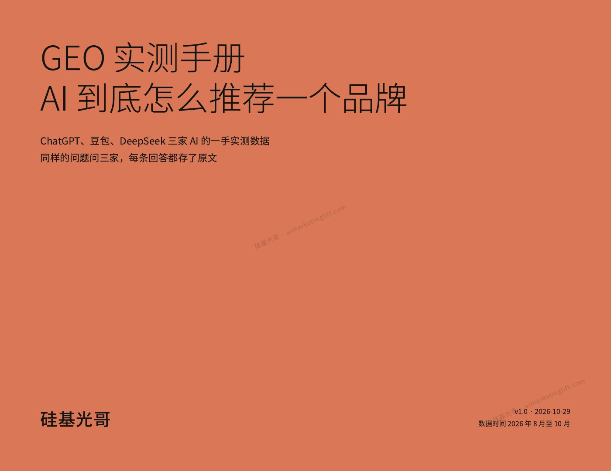

# GEO 实测手册

**AI 到底怎么推荐一个品牌** · 硅基光哥

用真实测试、原始截图和重复验证，拆解品牌在 AI 回答里被提及、被引用与被推荐的区别。适合正在做官网、品牌内容和 AI 搜索可见度测试的人。

**[下载 v1.0 正式 PDF](https://github.com/jiguang9/geo-field-guide/releases/download/v1.0/geo-handbook-v1.0.pdf)** · [最新版本](https://github.com/jiguang9/geo-field-guide/releases/latest) · [网站介绍与备用下载](https://aimarketinglift.com/geo-handbook)

50 页 · 8 章 + 附录 · 2026-10-29 发布 · 免费阅读



## 这本手册讲什么

同一个品牌，在 ChatGPT、豆包和 DeepSeek 里的表现可能完全不同；同一天重复问同一个问题，结果也会变化。手册从这些实测出发，说明如何设计问题、保存证据、统一判定口径，再判断网站和站外内容值得改什么。

案例反映测试时的模型、问题与环境，不代表所有品牌或未来结果。诊断分数、正文提及、官网被引、访问与转化需要分别看，不能互相替代。

## 目录

| 章节 | 内容 |
| --- | --- |
| 01 | 同一个品牌，三家 AI 待遇完全不同 |
| 02 | 测一次不算数，同一天问三次 |
| 03 | 怎么测才算数 |
| 04 | 诊断分数不等于被引用 |
| 05 | 网站这一层，哪些值得做 |
| 06 | 站外这一层，AI 读的大多不在官网 |
| 07 | 被引用之后，怎么量到 |
| 08 | 红线 |
| 附录 | 测试问题原文、判定口径、测试条件记录模板 |

## 怎么开始

1. 先读第 1–3 章，理解为什么要固定问题、记录测试条件并重复测试。
2. 用 PDF 附录中的测试条件记录模板，记录日期、平台、模型、联网状态、问题原文和回答证据。
3. 按同一口径区分正文提及、仅被引、仅检索到、无引用数据和未出现。负面提及需要单独标注。
4. 再读第 5–7 章，把内容改进与后续访问、转化观察接起来。

配套工具：[GEO 可见度判定助手](https://github.com/jiguang9/geo-judge) · [GEO 网站诊断 Skill](https://github.com/jiguang9/geo-audit)。工具的具体口径以各自版本说明为准。

## 下载与版本

正式 PDF 放在 [GitHub Releases](https://github.com/jiguang9/geo-field-guide/releases)，不需要安装软件或克隆仓库。进入对应版本，展开 **Assets**，选择 `geo-handbook-v1.0.pdf`；自动生成的 Source code 压缩包不包含 PDF。

每个正式版本对应一个 Git 标签、发布说明、PDF 和 SHA-256 校验文件。当前版本的文件信息见 [v1.0 发布清单](releases/v1.0.json)，历史变化见 [CHANGELOG](CHANGELOG.md)。

下载 PDF 与同一 Release 的 `SHA256SUMS.txt` 到同一目录后，可校验文件完整性：

```sh
# macOS
shasum -a 256 -c SHA256SUMS.txt
# Linux
sha256sum -c SHA256SUMS.txt
```

后续内容修订使用新版本发布，保留旧版本供引用和复核。更新规则见 [版本管理说明](VERSIONING.md)。

## 勘误与反馈

发现错字、数据口径或引用问题，可通过 [Issues](https://github.com/jiguang9/geo-field-guide/issues/new/choose) 提交。请写明版本、PDF 页码、问题和可复核的证据；不要提交账号信息或未获授权的私人数据。

## 作者与授权

作者：**硅基光哥**。公众号同名，更多实测文章见 [AI Marketing Lift](https://aimarketinglift.com/)。

手册及本仓库原创介绍内容沿用 **CC BY-NC-ND 4.0（署名—非商业性使用—禁止演绎）**，详见 [LICENSE](LICENSE.md) 和[官方许可条款](https://creativecommons.org/licenses/by-nc-nd/4.0/)。第三方商标、产品截图与引用材料的权利归原权利人；该许可不替代第三方材料本身的使用条件。

## English

A free, 50-page Chinese field guide to Generative Engine Optimization (GEO), based on hands-on tests of AI brand visibility. Covers repeatable testing, evidence capture, citation criteria, website and off-site content, and measurement. Download the official PDF from Releases. By 硅基光哥, licensed under CC BY-NC-ND 4.0.
